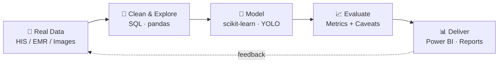

 

---

## 👋 About

- 🏥 Junior Assistant, **HIS IT** at HIMSR & HAHC Hospital, New Delhi (since May 2025)
- 🎓 B.Tech CSE (AI), Jamia Hamdard, **CGPA 8.74**
- 🎯 Looking for **Data Analyst / Computer Vision / AI-ML / Data Scientist** roles
- 📊 Built SQL reporting pipelines that cut manual reporting effort by ~40%

## 🔄 How I Work

## 🚀 Featured Projects

| Project | What it does | Stack | Result |
|---|---|---|---|
| [🏥 Hospital OPD Wait-Time Analysis](https://github.com/ALI-ASIF-GIT/hospital-opd-wait-time-analysis) | 5,000 OPD visits: SQL, prediction model, Power BI dashboard | Python · SQL · pandas · scikit-learn · Power BI | MAE ≈ 27 min |
| [😴 Driver Drowsiness Detection](https://github.com/ALI-ASIF-GIT/driver-drowsiness-detection) | Detects drowsy/yawning drivers in image, video, webcam | YOLOv8 · OpenCV · PyTorch | 98.0% mAP@0.5 |
| [⚔️ YOLOv5 vs YOLOv8](https://github.com/ALI-ASIF-GIT/Comparison-on-Custom-Object-Detection-using-YOLOv5-and-YOLOv8) | Same 12-class dataset, same recipe, side-by-side | YOLOv5 · YOLOv8 · Colab | 0.718 vs 0.721 mAP |
| [🚗 License Plate Recognition](https://github.com/ALI-ASIF-GIT/License-Plate-Recognition) | 7-step pipeline: locate plate, read with OCR | OpenCV · EasyOCR | Proof of concept |

## 🛠️ Tech Stack

## 📜 Certificates

- Google Data Analytics (Oct 2024)
- Google AI Essentials (Oct 2024)
- Getting Started with Deep Learning, NVIDIA (Nov 2024)

**Hiring for data or vision work? [Let's talk →](https://aliasif-dev.web.app/#contact)**

