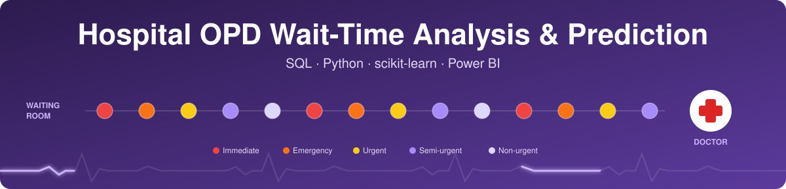

<p align="center">
  Turning <b>hospital data</b> into decisions and models.<br>
  I analyse operational data with <b>SQL, Python and Power BI</b>, and build <b>computer-vision systems</b> with YOLO and OpenCV.
</p>

<p align="center">
  <a href="https://linkedin.com/in/asif-ali-083202208"></a>
  <a href="mailto:asifaliali0989191@gmail.com"></a>
  <a href="https://ali-asif-git.github.io"></a>
  
</p>




## 👋 About me

```python
class AsifAli:
    role      = "Junior Assistant, HIS IT @ HIMSR / HAHC Hospital"
    education = "B.Tech CSE (AI), Jamia Hamdard, CGPA 8.74"
    location  = "New Delhi, India"
    works_on  = ["SQL reporting", "OPD / IPD data", "EMR modules"]
    builds    = ["Power BI dashboards", "YOLO detectors", "ML models"]
    looking_for = "Data Analyst / Computer Vision / AI-ML roles"

    def mindset(self):
        return "Clean data first, then clever models. Report limits honestly."
```

| 🔭 Building | 🌱 Learning | 💼 Looking for |
|---|---|---|
| Healthcare analytics and CV portfolio projects | Deeper ML, MLOps basics, model evaluation | Entry-level Data Analyst, CV and AI/ML roles |


## What I do

| 📊 Data Analytics | 👁️ Computer Vision & ML | 🏥 Healthcare IT |
|---|---|---|
| SQL reporting, data cleaning, EDA | Object detection with YOLOv5 / YOLOv8 | Hospital Information System (HIS) and EMR modules |
| Power BI dashboards for stakeholders | Real-time inference with OpenCV | OPD / IPD data workflows, LAN and HIS support |
| Predictive models with scikit-learn | Transfer learning, model comparison | Reporting automation, process stabilisation |


## Featured Projects

### 🏥 Hospital OPD Wait-Time Analysis & Prediction
<a href="https://github.com/ALI-ASIF-GIT/hospital-opd-wait-time-analysis"></a>

Built alongside my HIS IT role, on a public Kaggle dataset: end-to-end analytics on **5,000 OPD visits**: SQL and pandas cleaning, 9 business questions, three regression models tuned with GridSearchCV (Random Forest best, MAE ≈ 27 min) and a 3-page Power BI dashboard. Findings and limits are documented honestly in the repo.


[**View repository →**](https://github.com/ALI-ASIF-GIT/hospital-opd-wait-time-analysis)

### More projects

<table>
  <tr>
    <td width="50%" valign="top">
      <a href="https://github.com/ALI-ASIF-GIT/driver-drowsiness-detection"></a>
      <h4>🚗 Driver Drowsiness Detection</h4>
      <i>B.Tech final-year project.</i> Real-time drowsiness and yawning detection with a fine-tuned YOLOv8 on images, video and webcam. <b>98.0% mAP@0.5</b> on the validation set.<br><br>
      
      
      <br><br>
      <a href="https://github.com/ALI-ASIF-GIT/driver-drowsiness-detection"><b>View repository →</b></a>
    </td>
    <td width="50%" valign="top">
      <a href="https://github.com/ALI-ASIF-GIT/Comparison-on-Custom-Object-Detection-using-YOLOv5-and-YOLOv8"></a>
      <h4>⚔️ YOLOv5 vs YOLOv8</h4>
      <i>B.Tech project.</i> Same custom 12-class dataset, same recipe, side-by-side metrics and detections. Near-identical mAP, with YOLOv8 more confident on most shared objects.<br><br>
      
      
      <br><br>
      <a href="https://github.com/ALI-ASIF-GIT/Comparison-on-Custom-Object-Detection-using-YOLOv5-and-YOLOv8"><b>View repository →</b></a>
    </td>
  </tr>
</table>

Also: [**License Plate Recognition**](https://github.com/ALI-ASIF-GIT/License-Plate-Recognition), a B.Tech project: an OCR + OpenCV pipeline (ROI extraction, noise reduction, contour detection).


## Tech Stack

<p align="center"></p>

**Languages** &nbsp;


**Data & BI** &nbsp;


**AI / ML** &nbsp;


**Tools** &nbsp;


## Experience

**Junior Assistant, HIS IT** · Hamdard Institute of Medical Sciences & Research (HIMSR) and HAHC Hospital · *May 2025 to present*

- Manage core **HIS and EMR modules** (OPD, IPD, Reports), improving data-handling efficiency by about 25%.
- Built **automated SQL reporting pipelines**, cutting manual reporting effort by about 40%.
- Proposed AI-based triage automation concepts for real hospital workflows.
- Resolved LAN and HIS access issues to keep systems up for clinical staff; stabilised POS payment operations.

## Education & Certifications

| | |
|---|---|
| 🎓 **B.Tech, CSE (Artificial Intelligence)** | Jamia Hamdard, New Delhi · 2020 to 2024 · CGPA 8.74 / 10 |
| 📜 Google Data Analytics | Coursera · Oct 2024 |
| 📜 Google AI Essentials | Coursera · Oct 2024 |
| 📜 Getting Started with Deep Learning | NVIDIA · Nov 2024 |


## Let's connect

I'm looking for **Data Analyst, Computer Vision and AI/ML roles** where healthcare-grade data discipline meets applied machine learning. The fastest way to reach me is [LinkedIn](https://linkedin.com/in/asif-ali-083202208) or [email](mailto:asifaliali0989191@gmail.com).


